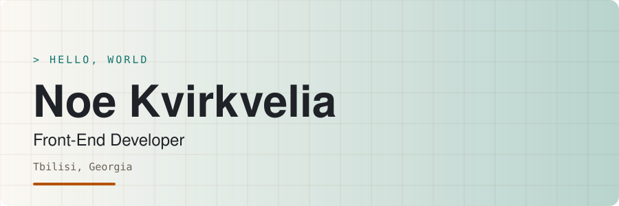
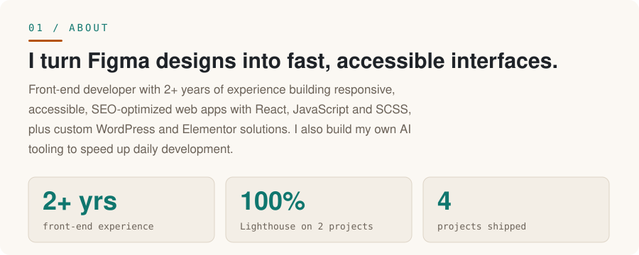
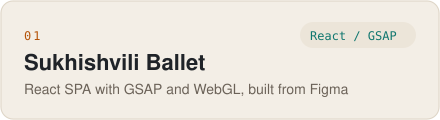
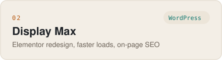
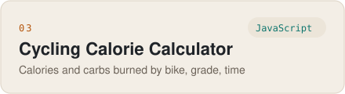
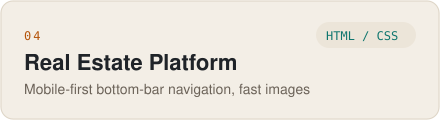
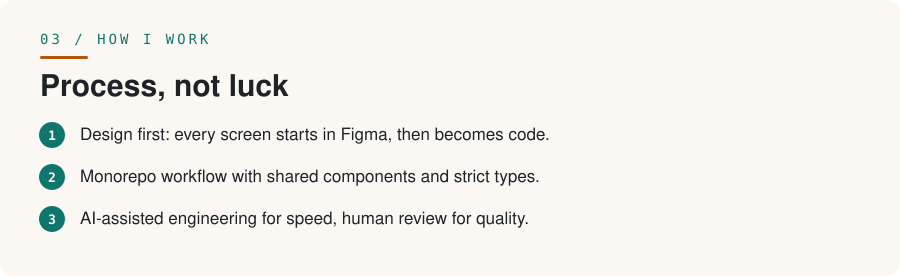
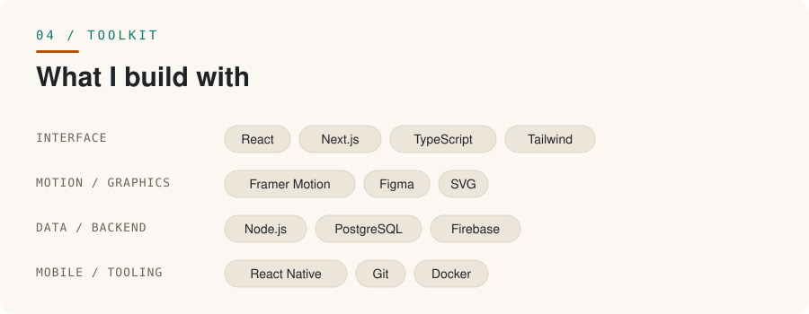
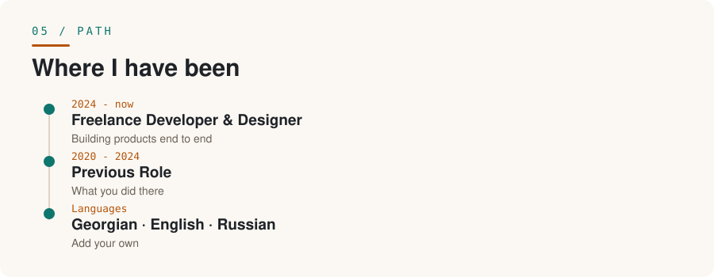

<picture>
  <source media="(prefers-color-scheme: dark)" srcset="assets/dark/hero.svg">
  
</picture>

<picture>
  <source media="(prefers-color-scheme: dark)" srcset="assets/dark/about.svg">
  
</picture>

<picture>
  <source media="(prefers-color-scheme: dark)" srcset="assets/dark/work.svg">
  
</picture>

<table align="center" width="900">
  <tr>
    <td>
<a href="https://example.com"><picture>
  <source media="(prefers-color-scheme: dark)" srcset="assets/dark/card1.svg">
  
</picture></a>
    </td>
    <td>
<a href="https://example.com"><picture>
  <source media="(prefers-color-scheme: dark)" srcset="assets/dark/card2.svg">
  
</picture></a>
    </td>
  </tr>
  <tr>
    <td>
<a href="https://example.com"><picture>
  <source media="(prefers-color-scheme: dark)" srcset="assets/dark/card3.svg">
  
</picture></a>
    </td>
    <td>
<a href="https://example.com"><picture>
  <source media="(prefers-color-scheme: dark)" srcset="assets/dark/card4.svg">
  
</picture></a>
    </td>
  </tr>
</table>

<picture>
  <source media="(prefers-color-scheme: dark)" srcset="assets/dark/how.svg">
  
</picture>

<picture>
  <source media="(prefers-color-scheme: dark)" srcset="assets/dark/toolkit.svg">
  
</picture>

<picture>
  <source media="(prefers-color-scheme: dark)" srcset="assets/dark/path.svg">
  
</picture>

<picture>
  <source media="(prefers-color-scheme: dark)" srcset="assets/dark/signal.svg">
  
</picture>

<picture>
  <source media="(prefers-color-scheme: dark)" srcset="assets/dark/contact.svg">
  
</picture>

<a href="https://linkedin.com/in/YOUR_HANDLE"><picture>
  <source media="(prefers-color-scheme: dark)" srcset="assets/dark/btn1.svg">
  
</picture></a> <a href="https://instagram.com/YOUR_HANDLE"><picture>
  <source media="(prefers-color-scheme: dark)" srcset="assets/dark/btn2.svg">
  
</picture></a> <a href="mailto:you@example.com"><picture>
  <source media="(prefers-color-scheme: dark)" srcset="assets/dark/btn3.svg">
  
</picture></a>

<picture>
  <source media="(prefers-color-scheme: dark)" srcset="assets/dark/footer.svg">
  
</picture>

